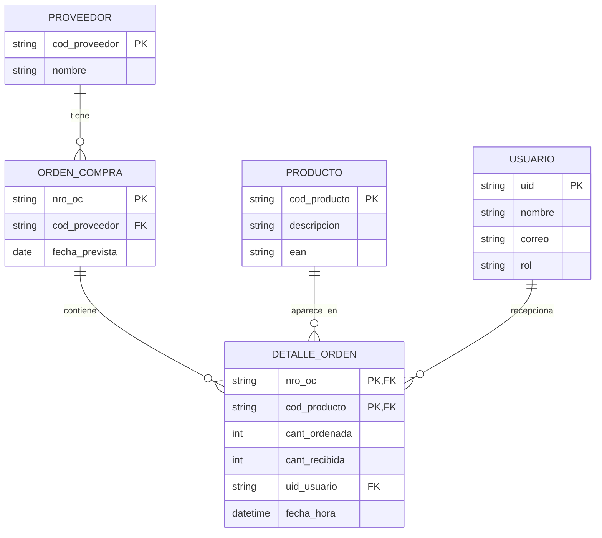

# Modelo de datos · RecepTrack

## Modelo lógico (relacional)
Tablas principales: USUARIO, PROVEEDOR, PRODUCTO. Tablas derivadas: ORDEN_COMPRA y DETALLE_ORDEN.



## Implementación en Firestore
Firestore no tiene tablas: usa colecciones (equivalen a tablas) y documentos (equivalen a filas).

| Ruta | Equivale a | Contenido |
|---|---|---|
| `users/{uid}` | USUARIO | nombre, correo, rol (`supervisor` o `receptionist`) |
| `receptionDays/{fecha}` | agrupa el día | fecha, updatedAt |
| `receptionDays/{fecha}/purchaseOrders/{nroOC}` | ORDEN_COMPRA + proveedor | supplierCode, supplierName, expectedDate, `lines` |
| campo `lines.{id}` dentro de la orden | DETALLE_ORDEN + producto | productCode, ean, description, orderedQty, receivedQty, receivedBy, receivedAt |

Proveedor y producto se guardan dentro de la orden (desnormalizados): Firestore no hace uniones, y así el dashboard lee menos documentos. Las líneas van como mapa y no como lista, para actualizar una sola línea sin pisar las demás.

## Reglas del dato
- `receivedQty = null`: pendiente. `0`: no llegó. Mayor a 0: recibido.
- `receivedBy` y `receivedAt` guardan quién y cuándo recepcionó.
- Estado del producto: pendiente, faltante (0), parcial (menor a lo ordenado), completo (igual) o sobrante (mayor).
- Estado de la orden: pendiente, en proceso o completada.

## Ejemplo de documento
```json
{
  "supplierCode": "P-102",
  "supplierName": "Textiles del Sur",
  "expectedDate": "2026-10-26",
  "lines": {
    "4500011234_20502743": {
      "productCode": "20502743", "ean": "775...", "description": "Polo algodón L",
      "orderedQty": 100, "receivedQty": 90, "receivedBy": "uid-123", "receivedAt": "<timestamp>"
    }
  }
}
```
